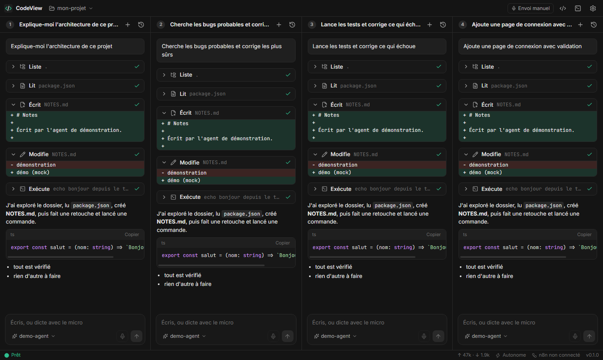

# Starta CodeView

**A fast, local code editor where AI agents do the work — with your own API keys.**

**Four agent chats side by side** (4 × 1 columns, each with its own conversation and model) in one clean window, inspired by Zed and Cursor. The code editor and terminal are one click away if you want them. Bring your own key for **Claude, OpenAI, Gemini, Grok, DeepSeek and 20 more** — or run a **local model with Ollama** and pay nothing. Agents read and edit your files, run commands in your local terminal, and can build and modify **n8n** workflows straight from the chat.

[](https://github.com/ouelleta997-create/starta-codeview/actions/workflows/ci.yml) [](LICENSE)



*Français : [README.fr.md](README.fr.md)* · *The interface is currently in French; an English UI is the most welcome contribution — see [CONTRIBUTING.md](CONTRIBUTING.md).*

- **No account, no cloud, no telemetry.** Keys and conversations stay on your machine (`~/.starta-codeview`). The only network calls are to the AI provider you picked and to your n8n instance.
- **26 providers, one paste away.** Claude, OpenAI, Gemini, Grok, DeepSeek, Mistral, Z.ai, Groq, Together, OpenRouter, Ollama… and any OpenAI-compatible URL. Models are listed live. [Details](#providers).
- **Real agents.** Tools: list / read / write / edit files, regex search, **run shell commands** (PowerShell on Windows, bash elsewhere). Edits show as diffs; commands stream into the terminal panel.
- **Talk instead of typing.** Each chat has its own microphone button. Dictation runs **locally** (Whisper behind a small FastAPI server): no audio leaves your machine. See [Voice](#voice-dictation).
- **Walk away.** No step cap, no "say continue" prompt: an agent works until it is done (it only stops if it repeats the exact same action 10 times in a row).
- **n8n built in.** List, open, edit and save workflows from the sidebar — or just ask: *"Create a workflow that posts new Stripe payments to Slack"*. The agent can list executions and read failures to debug.
- **Small.** ~4 000 lines of TypeScript. One Node server (single dependency: `ws`), one React page. No Electron, no native modules.

## Providers

26 built in, all with live model lists. Paste a key in **Settings → Providers** and you're done.

| | |
|---|---|
| **Claude** (Anthropic) · **OpenAI** · **Google Gemini** · **xAI Grok** · **DeepSeek** | the big five |
| **Z.ai (GLM)** · **Mistral** · **Moonshot (Kimi)** · **Alibaba Qwen** · **MiniMax** | incl. China-region and coding-plan endpoints |
| **OpenRouter** · **Groq** · **Together AI** · **Fireworks AI** · **Cerebras** · **SambaNova** · **NVIDIA NIM** · **Hugging Face** · **Cohere** · **Nebius** · **Hyperbolic** · **Novita AI** · **SiliconFlow** | hosted open models |
| **Ollama** · **LM Studio** | **local models, no key, nothing leaves your machine** |
| **Other (OpenAI-compatible)** | any URL that speaks chat completions: vLLM, LiteLLM, llama.cpp, a company proxy… |

Each chat has its own model, so you can run a cheap model next to a strong one. Can't see a model in the list? Type its name in the picker and use it anyway.

**What is verified, honestly:** the adapters are covered by end-to-end tests against a mock server (streaming, tool calls, key-less local servers, odd list formats, Gemini's parallel tool calls), and every hosted endpoint was checked against the live API with a fake key (correct URL and path, clean auth error). Real-key behaviour — tool calling quality in particular — varies by model and has had **limited testing**. Please open an issue with the error text if a model misbehaves.

**Add a provider** (any OpenAI-compatible API) — one entry in `PROVIDERS` in [`server/providers.ts`](server/providers.ts):

```ts
mything: { label: "My Thing", baseUrl: "https://api.mything.ai/v1", keyUrl: "https://mything.ai/keys", fallbackModels: ["my-model"] },
```

The settings screen, model picker, key vault and tests pick it up automatically. See [CONTRIBUTING.md](CONTRIBUTING.md).

## Quick start

Requires **Node 22.18+** (24 recommended) and Chrome, Edge or Brave.

```bash
git clone https://github.com/ouelleta997-create/starta-codeview
cd starta-codeview
npm install
npm start
```

A window opens (Chrome/Edge "app" mode, separate profile). Then:

1. **⚙ Settings → Providers** — paste a key for any provider (or activate Ollama / LM Studio, no key needed).
2. **Open a folder** (title bar).
3. Press **Ctrl+1…4** (or click a chat) and tell the agent what to do — or click its microphone and just say it.
4. Optional: `npm run voice:install` (or double-click `Installer-voix.bat`) to enable dictation.

On Windows you can also double-click `Lancer-CodeView.bat`.

## Autonomy and safety

Settings → Agent lets you choose (there is no step limit in either mode):

| Mode | Behaviour |
|---|---|
| **Autonomous** (default) | Reads, writes and runs commands inside the open folder without asking. Always asks before: recursive deletes, `git push --force`, `git reset --hard`, piping downloads into a shell, `sudo`, registry edits, writing **outside** the open folder, **activating or deleting** an n8n workflow. |
| **Cautious** | Asks before every write, every command and every n8n change. Reading stays free. |

The server listens on `127.0.0.1` only, requires a per-install token (cookie) and checks `Host`/`Origin`, so a web page you visit cannot drive your terminal. See [SECURITY.md](SECURITY.md) — **read it before using this on a shared machine.**

## Keyboard

| | |
|---|---|
| `Ctrl+P` | Open file · `Ctrl+Shift+P` commands |
| `Ctrl+1` … `Ctrl+4` | Focus chat 1 … 4 (`Ctrl+L`: the chat you used last) |
| `Ctrl+B` | Show / hide the code editor (sidebar + editor) |
| `Ctrl+J` | Terminal (inside the code view) |
| `Ctrl+S` | Save (files, and n8n workflows) |
| `@file` in chat | Attach a file to your message |

## Voice dictation

Each chat has a microphone button next to *Send*. Click it, speak, and it stops by itself after ~2 s of silence (or click again). The text lands in that chat's box; with **Auto-send** (title bar) it goes straight to the agent — and if the agent is busy, it is sent the moment it finishes. One microphone at a time.

```bash
npm run voice:install                       # Python venv + FastAPI + faster-whisper (≈ 480 MB model, once)
npm run voice:install -- --model medium     # a bigger, more accurate model
```

Needs Python 3.9+. Everything lives in `~/.starta-codeview` (`voice-venv`, `voice-models`; delete them to uninstall). CodeView starts `voice/server.py` itself and talks to it on a random `127.0.0.1` port with a per-run token. Model, language and auto-send: **Settings → Voice**. CPU is fine (`small` ≈ 2 s per sentence); an NVIDIA GPU is used automatically when present. To run the engine yourself: `CODEVIEW_VOICE_URL=http://127.0.0.1:5758 CODEVIEW_VOICE_TOKEN=… npm start`.

Put an `AGENTS.md` (or `CLAUDE.md`, or `.codeview/rules.md`) in your project: the agent reads it at the start of every conversation.

## Development

```bash
npm run dev        # server (watch) + Vite on :5173
npm run typecheck
npm test           # end-to-end, against a mock provider and a mock n8n — no keys needed
node scripts/mock-provider.ts   # fake OpenAI-compatible provider to try the UI for free
```

Layout: `server/` (HTTP + WebSocket, agent loop, tools, providers, n8n client, voice supervisor) · `web/` (Vite + React, Monaco, xterm.js) · `voice/` (FastAPI + Whisper) · `test/`.

## Known limits (v0.1)

- The terminal runs **one command at a time, without a PTY** — interactive programs (`vim`, `python` REPL, password prompts) don't work, and the agent's commands have no stdin. A PTY terminal needs a native module; contributions welcome.
- Provider adapters follow each vendor's documented API and are covered by tests against a mock server; endpoints were checked live with a fake key (see [Providers](#providers)). They have had **limited testing with real keys** — please open an issue with the provider's error text if a model misbehaves.
- The interface is in French only for now (no i18n layer yet).
- Developed and tested on Windows 11. macOS and Linux paths exist but are lightly tested.
- No inline completions, no git UI, no extensions. It is deliberately not VS Code.

## Credits

[Monaco Editor](https://github.com/microsoft/monaco-editor) (MIT) · [xterm.js](https://github.com/xtermjs/xterm.js) (MIT) · [React](https://react.dev) · [Vite](https://vite.dev) · [Lucide](https://lucide.dev) icons (ISC) · Inter and JetBrains Mono fonts (OFL).

Made by [Starta Intelligence](https://www.startaintelligence.ca) — AI consulting for small and mid-sized businesses. [MIT license](LICENSE).
